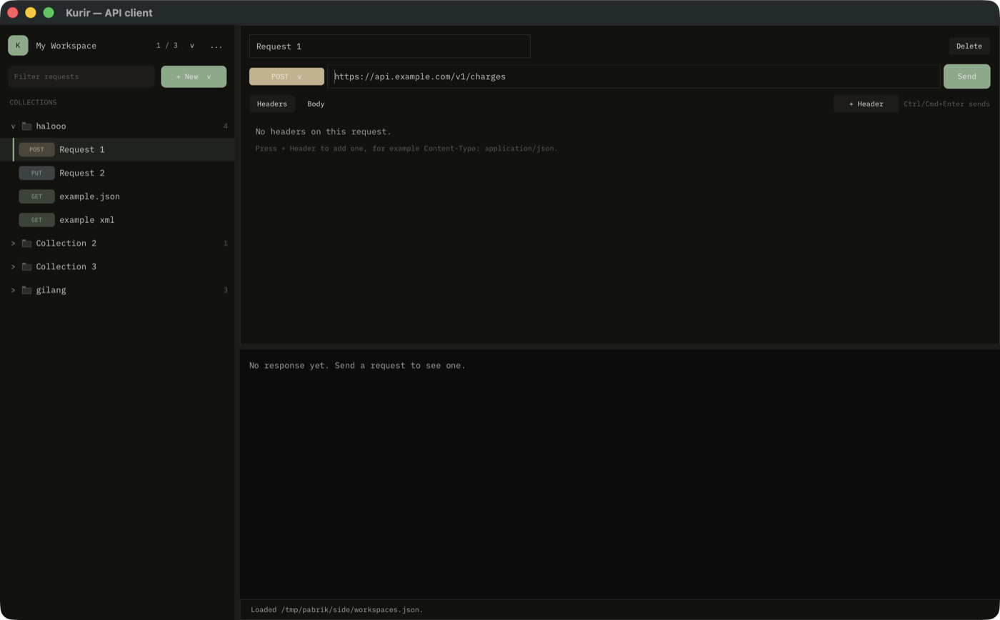

# Kurir

A small, fast desktop app for sending HTTP requests — the everyday Postman job, without the
account, the cloud, or the browser tab.



## What it does

- **Organise your requests.** Workspaces → collections → folders → requests. Switch workspace with one
  click, collapse a folder, find a request by typing part of its name or URL. **Drag any row** to move
  it: onto the top or the bottom of another row to reorder, or onto the middle of a folder or a
  collection to drop it inside — the row goes where you let go, and the container opens to show it.
  Right-click a request for **Rename**, **Duplicate** and **Delete** — up to you whether the menu is
  the keyboard or the mouse.
- **Send and read.** Pick a method (GET, POST, PUT, PATCH, DELETE, HEAD, OPTIONS), paste a URL, add
  headers and a body, press Send. You get the status, the time, the size, the pretty-printed body
  and the response headers — and the last answer for each endpoint is kept while you look elsewhere.
- **Every send is remembered.** The response pane has a **History** tab: the last **20** results of
  the session with their method, name, status, time, size and age. Press one to see that answer again;
  the request it belongs to is selected for you, and sending again goes back to the newest.
- **Tabs, and nothing saved behind your back.** Every endpoint you open gets a tab at the top; press one
  to come back to it, and `x` to close it. Editing does not write the file: a dot on the row and the tab
  says the endpoint has unsaved changes, and **Ctrl/Cmd+S** writes them. A save is per tab — the tab on
  screen goes clean and the other tabs keep their dots until you save each one — while "Save and quit"
  saves the lot. Closing the window with unsaved edits asks first — save and quit, quit without saving,
  or cancel.
- **A body the way Postman writes one.** The Body tab offers **none**, **form-data**,
  **x-www-form-urlencoded** and **raw** (JSON, text, XML or HTML). The two form modes edit a
  key/value table with an on/off per row; sending builds the right bytes and the matching
  `Content-Type` — a URL-encoded pair list, or a real multipart body with its own boundary.
  A raw JSON body can be laid out with one press of **Prettify**.
- **The response is text you can use.** Click into the body, drag to select, Cmd/Ctrl+C to copy — and
  nothing you type can change it. A multi-megabyte answer still scrolls smoothly.
- **It never freezes.** A request runs on its own thread, so the window keeps drawing while a slow
  server answers.
- **Your work is saved when you ask.** No Save button in the way, no "unsaved changes" dialog while you
  work: Ctrl/Cmd+S writes the file and clears that tab's dot, and a dot still on another tab means that
  endpoint has not been saved yet.
- **It speaks Postman.** Export a collection as Postman Collection v2.1, or import a real Postman file
  without losing the fields Kurir does not understand.
- **It speaks curl.** Copy a `curl …` command anywhere and press **+ New → From cURL**: method, URL,
  headers and body come across, and the request is named after its own URL. The **cURL** button next
  to Send goes the other way — the request as a command you can paste into any terminal.
- **Scripts, before and after the send.** The request's **Scripts** tab carries a **Pre-req** and a
  **Post-res** script in a small Lua-flavoured language: `local`, `if … then … else … end`, `..` to join
  text, `pm.response.json()` / `.text()` / `.code` / `.headers.get(name)`, and
  `pm.environment.set(name, value)` (Postman's `pm.globals` means the same here). So a login answer's
  token becomes a variable the next request sends:

  ```lua
  local jsonData = pm.response.json()
  pm.environment.set("token", jsonData.access_token)
  print("Access Token: " .. jsonData.access_token)
  ```

  `print()` and `console.log()` land under the field; a script that cannot run says which line, and a
  failing Pre-req stops the send instead of sending a request it could not prepare. No loops, no
  function definitions — anything else is a line and a sentence, never a crash.


## Install

macOS and Linux, one command:

```sh
curl -fsSL https://raw.githubusercontent.com/ginwa123/kurirw/main/install.sh | sh
kurirw
```

Windows, one command (PowerShell, no admin):

```powershell
irm https://raw.githubusercontent.com/ginwa123/kurirw/main/install.ps1 | iex
```

Either installer fetches the right binary for your machine from the
[latest release](https://github.com/ginwa123/kurirw/releases/latest) and puts it on your PATH. You can
also download the archive yourself and run the binary inside it.

> macOS note: the build is not signed yet, so the first launch needs right-click → **Open**, or
> `xattr -d com.apple.quarantine kurirw`.
>
> Windows note: TLS goes through Windows' own certificate store (Schannel), so there is no OpenSSL
> DLL to install and no CA bundle to keep up to date — `https://` just works. The same is true of the
> app's own copy of the HTTP library: it is linked in, not something you install.

## First five minutes

1. Press **+ New → Collection** on the left, name it anything.
2. Press **+ New → Request**, then paste a URL — try `https://jsonplaceholder.typicode.com/todos/1`.
3. Press **Send**. The response appears in the pane below; drag the line above it to make the pane
   bigger.
4. Switch to **Body** to pick how it sends — raw JSON, a form table, or nothing — or **+ Header** to
   add a header. Ctrl/Cmd+Enter sends from the body editor.
5. **+ New → Import** takes a Postman collection file. The `...` next to the workspace name exports one.
6. **+ New → From cURL** turns a `curl …` command you copied into a request; the **cURL** button beside
   Send copies the request you are looking at back out as a command.
7. Press **History** in the response pane to see the last twenty answers; press one to bring it back.
8. Click into the response body to select a value and copy it — the pane is a read-only text editor,
   so drag-select, double-click-a-word and Cmd/Ctrl+A all work.

## Where your work is kept

Two plain JSON files in the same folder:

| | |
|---|---|
| `workspaces.json` | the document — written when you press **Ctrl/Cmd+S** (or "Save and quit") |
| `session.json` | what was on screen — the tabs you had open, and the edits nobody saved yet, written when the window closes |

Both live in `~/.kurir/` by default, or in `$KURIR_HOME/` when that is set.

Back them up, `git init` them, or copy them to another machine — they are plain files, and the
collections inside them are ordinary Postman v2.1 documents. Delete `session.json` to start with an
empty window; the document is untouched.

## Build it yourself

You need [Zig 0.16](https://ziglang.org/download/) and nothing else to start: the two libraries Kurir
uses are pinned in `build.zig.zon` and fetched for you.

```sh
git clone https://github.com/ginwa123/kurirw
cd kurirw
zig build run      # open the window
zig build test     # 75 tests: the model, the file, the UI, and a headless end-to-end run
```

System libraries, per platform:

- **macOS** — `brew install curl openssl@3`
- **Linux** — the Wayland/EGL/GLES3 + pango stack, plus `libcurl4-openssl-dev` and `libssl-dev`
  (the exact list is in `.github/workflows/ci.yml`)
- **Windows** — nothing at all. The HTTP library (a real, statically linked libcurl) comes with the
  source tree: `kabelweb` ships `vendor/curl/windows-amd64/lib/libcurl.a`, built by its
  `scripts/build-vendor-curl-windows.sh` with `zig cc` and Schannel as the only TLS backend.

Whatever you build, `-Drequire-real-curl=true` makes a build fail instead of silently linking a
stand-in HTTP library that cannot send anything — CI passes it on every platform.

Every push runs the same three-platform CI: build, the full test suite, the linters, two **real
network** requests (a local HTTP server and `https://example.com/` through the production transport,
which is what catches a build that cannot actually send), and a **ReleaseFast** binary for each
platform. A `v*` tag publishes those binaries as a release.

## How it is built

Zig 0.16, with the user interface on [glinlandui](https://github.com/ginwa123/glinlandui) — a small
retained-mode toolkit with its own Cocoa, Wayland and Win32 backends — and HTTP through
[kabelweb](https://github.com/ginwa123/kabelweb)'s libcurl client. The code is split the way the UI is
(sidebar / editor / response, each with its own view model and screen) and the document layer never
imports a widget, which is what lets the whole thing be tested headlessly.

Architecture, the Postman round-trip rules, the widget choices and the known limitations live in
**[docs/ARCHITECTURE.md](docs/ARCHITECTURE.md)**.

## License

MIT.
